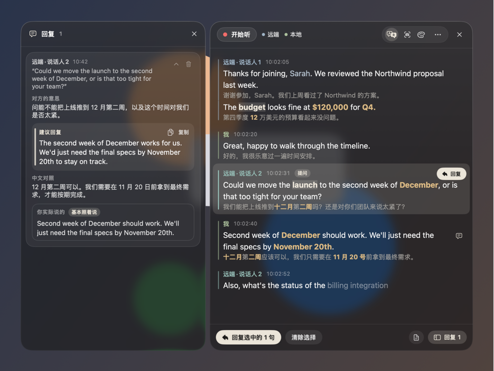
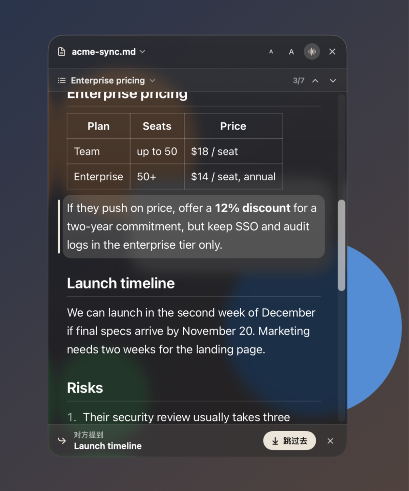
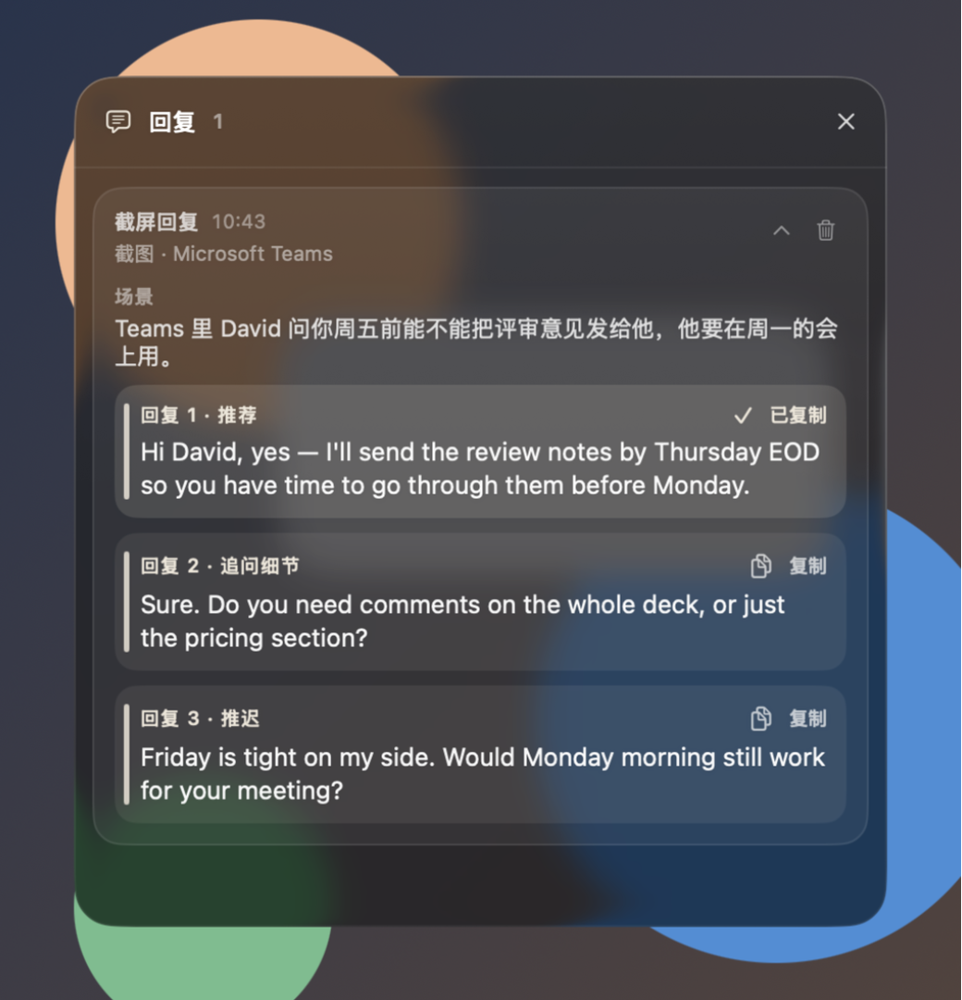

# Tyto · Listen, translate, reply

**English** · [中文](README.zh-CN.md)

A floating meeting assistant for macOS. Follow the conversation with bilingual captions, turn a question into a suggested reply, and keep your speaking notes beside the call.

[Download](https://github.com/ethannortharc/tyto/releases) · [Quick start](#quick-start) · [User guide](docs/guide.md)



*Actual Tyto windows with built-in sample conversations. The transcript is on the right; the reply and “What you said” comparison are on the left.*

## During the meeting

- **Read both languages.** Capture the meeting app's audio and your microphone separately. Show a translation beneath each line; highlight questions, dates, amounts, and your own keywords.
- **Find the words to answer.** Select one or more lines and ask for a reply. Tyto uses your meeting background and selected skills, then shows what the question means, what you can say, and a translation.
- **Keep your place.** Open Markdown, HTML, or plain-text notes in the prompter. Follow mode highlights the paragraph you are reading; section hints help you jump to a topic the other person mentions.
- **Use as much space as you need.** Switch between the full overlay, a compact caption bar, and a button bar. Each remembers its position.
- **Review afterward.** Save transcripts and replies to Meeting Records, search past meetings, export Markdown, or continue a session.

Tyto excludes its own windows from screen capture. System dialogs and some macOS menus can still appear; see the [sharing checks](docs/share-check.md) and [known limitations](#known-limitations).

## Beyond captions

### Notes that follow your speech

The prompter has its own floating window, section navigation, and local matching across the original speech and its translation. Changes to the notes file appear automatically.



*Native prompter screenshot with bundled sample notes and a simulated follow/hint state.*

### Turn a screenshot into a reply

Press **⌃⌥S** over a chat or email. Tyto reads the context and offers three replies; the first is copied to your clipboard. Add an instruction to change the tone or language, then regenerate.



*Native reply panel with a built-in sample message and sample replies.*

## Quick start

**Requires macOS 26 or later on Apple silicon.**

1. Download the latest `Tyto-x.y.z.dmg` from [Releases](https://github.com/ethannortharc/tyto/releases), drag Tyto into Applications, and open it.
2. In **Translation**, choose your main language and download Apple's language pair if needed. On-device captions and translation require no API key.
3. For suggested replies, add a provider in **Models & services**, then choose a model under **Uses → Reply**. Keys are stored in the macOS Keychain.
4. Press **⌃⌥L** and grant **System Audio Recording** and **Microphone** permissions when macOS asks. For screenshot replies, also enable **Screen & System Audio Recording**, then reopen Tyto.

Before a call, add its purpose, attendees, and useful terms in **Session**. During the call, select a caption and press **⌃⌥R**. Afterward, choose **Save to Meeting Records** from the ⋯ menu.

The interface supports Chinese and English. Tyto can run from the menu bar, start at login, and install verified updates when you quit. See [installation and first run](docs/guide.md#install).

## Shortcuts

These work while your meeting app is in front. **⌃⌥** means Control + Option.

| Shortcut | Action |
|---|---|
| ⌃⌥L | Start / stop listening |
| ⌃⌥R | Reply to selected lines, or the latest |
| ⌃⌥S / ⌃⌥A | Screenshot reply / select an area |
| ⌃⌥M | Full overlay → caption bar → button bar |
| ⌃⌥B | Show / hide replies |
| ⌃⌥N | Show / hide the prompter |
| ⌃⌥↑ / ⌃⌥↓ | Previous / next notes section |
| ⌃⌥J | Jump to the section just mentioned |

[All shortcuts and appearance controls →](docs/guide.md#keyboard-shortcuts)

## Choose where processing happens

| Task | On your Mac | Optional service |
|---|---|---|
| Transcription | Apple on-device recognition | Real-time speech services, transcription APIs, or audio models |
| Translation | Apple on-device translation | Your chosen language model |
| Replies | A local Ollama / LM Studio model | Anthropic, OpenAI, OpenRouter, Gemini, or another supported provider |
| Screenshot reading | Apple OCR or a local vision model | Your reply model or a separate vision provider |
| Prompter matching and meeting records | Local matching and local files | — |

With cloud services, the relevant audio, text, or image goes to the provider you select. Reading a screenshot locally keeps the **image** local; extracted text can still go to a cloud reply model. See [models and services](docs/guide.md#models-and-services) and the [full data-flow table](docs/guide.md#privacy-what-leaves-your-mac).

## Build from source

Requires Xcode 26 / Swift 6.2. From the repository root:

```sh
scripts/build-app.sh
open build/Tyto.app
```

[Build, release, and self-test commands](docs/guide.md#build-from-source) · [Media capture runbook](.demo-studio/runbook.md)

## Known limitations

- System audio includes every app except Tyto. Other music or videos can enter the transcript.
- File pickers, permission prompts, Keychain dialogs, and the macOS menu bar may appear in a screen share. Google Meet in Chrome has not been tested directly.
- The real-time speech integrations have local protocol tests; long real-meeting validation is still pending.

## License

[MIT](LICENSE). Bundled dependency licenses and credits are in the [user guide](docs/guide.md#license).

*Tyto* is the barn owl genus; the Chinese name 听译 means “listen and translate”.

© 2026 Ethan H.B. Zhou
